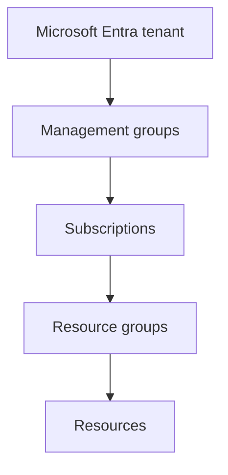

---
tags:
  - cloud
  - azure
---

# Azure

**Certification:** Microsoft Azure Administrator (AZ-104)

## Resource hierarchy



Policies and RBAC assignments set at a higher level are inherited by everything below.

## Reliability building blocks

- **Availability Zones**: physically separate datacenters within a region.
- **Availability sets**: spread VMs across fault and update domains when zones aren't available.
- **Virtual Machine Scale Sets**: autoscaling groups of identical VMs.
- **Region pairs**: plan disaster recovery into the paired region.
- **SLAs**: a composite SLA is the product of each dependency's SLA, so chaining services lowers it.

## Handy CLI

```bash
az account show -o table
az group list -o table
az vm list -d -o table          # includes power state
az aks get-credentials -g <rg> -n <cluster>
```
