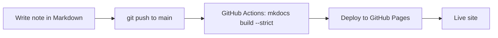

---
hide:
  - toc
---

# DevOps & SRE Skill Bank

Hands-on notes, runbooks and lessons from about 19 years in IT operations, cloud reliability
and production support. Everything here is something I've used, studied or broken and fixed.

-   :material-kubernetes:{ .lg .middle } **Kubernetes**

    ---

    Cluster operations, troubleshooting workloads, and CKA-level skills.

    [:octicons-arrow-right-24: Kubernetes notes](kubernetes/index.md)

-   :material-cloud-outline:{ .lg .middle } **Multi-cloud**

    ---

    Core services and patterns on AWS, Azure and GCP.

    [:octicons-arrow-right-24: Cloud notes](cloud/index.md)

-   :material-chart-timeline-variant:{ .lg .middle } **Site Reliability Engineering**

    ---

    SLOs, error budgets, incident response and blameless postmortems.

    [:octicons-arrow-right-24: SRE practices](sre/index.md)

-   :material-source-branch:{ .lg .middle } **CI/CD & IaC**

    ---

    Pipelines with GitHub Actions and infrastructure with Terraform.

    [:octicons-arrow-right-24: GitHub Actions](ci-cd/github-actions.md) ·
    [Terraform](iac/terraform.md)

-   :material-linux:{ .lg .middle } **Linux**

    ---

    A fast triage checklist for slow or broken hosts.

    [:octicons-arrow-right-24: Linux troubleshooting](linux/troubleshooting.md)

-   :material-shield-lock-outline:{ .lg .middle } **Cloud security**

    ---

    My learning path into cloud security and hardening.

    [:octicons-arrow-right-24: Security](security/index.md)

## Certifications

| Certification | Issuer |
|---|---|
| Certified Kubernetes Administrator (CKA) | CNCF / Linux Foundation |
| AWS Certified Solutions Architect – Associate | Amazon Web Services |
| Google Cloud Associate Cloud Engineer | Google Cloud |
| Microsoft Azure Administrator (AZ-104) | Microsoft |

## How this site is built

The site is itself a small DevOps project: version-controlled content, a CI build that fails on
broken links, and automatic deployment.
