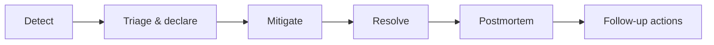

---
tags:
  - sre
  - runbook
---

# Incident response

**Goal:** restore service first, find root cause later.

## Lifecycle

## Roles

| Role | Responsibility |
|---|---|
| Incident commander | Owns the incident, makes decisions, keeps people focused |
| Operations lead | Hands on keyboard, runs the fixes |
| Communications lead | Status page, stakeholder updates on a fixed cadence |
| Scribe | Keeps the timeline: what happened, when, who decided what |

In a small team one person can hold several roles, but name the incident commander explicitly.

## Severity levels (example)

| Sev | Definition | Response |
|---|---|---|
| SEV1 | Major user-facing outage or data loss | All hands, updates every 30 min |
| SEV2 | Significant degradation, workaround exists | On-call + owners, updates hourly |
| SEV3 | Minor impact, single component | Fix in business hours |

## First 15 minutes checklist

- [ ] Acknowledge the page and open an incident channel
- [ ] Name the incident commander
- [ ] State the user impact in one sentence
- [ ] Check what changed: deploys, config, feature flags, infra
- [ ] Mitigate: roll back, fail over, scale up, or disable the feature
- [ ] Send the first stakeholder update
